  

<pre>
mert@github:~$ whoami
Mert Yücesoy · frontend &amp; mobile developer · Turkey
Web at work (React, Next.js, Angular), my own apps after hours (Expo, SwiftUI).

mert@github:~$ ls ~/projects
<a href="https://github.com/yucesoymert/Morph">morph/</a>          two images → one dynamic macOS wallpaper (.heic)   SwiftUI
diarywhisper/   diary, mood &amp; breathing app                        Expo · React Native
pixdaily/       one photo a day → a pixel art calendar             iOS · in planning
<a href="https://portfolio-v0-indol.vercel.app">portfolio/</a>      my site                                            React
<a href="https://github.com/yucesoymert/react-pokedex">pokedex/</a>        one of my first React projects, kept with love     React

mert@github:~$ cat stack.txt
lang      TypeScript · JavaScript · Swift
web       React · Next.js · Angular · Tailwind · Sass
mobile    Expo / React Native · SwiftUI
backend   Firebase · Sanity

mert@github:~$ history | tail -4
2022  bootcamps → first public repos
2024  Ithinka · client projects (private, Azure DevOps)
2025  NoSurrender · web &amp; mobile (private GitHub org)
2026  shipping my own apps

mert@github:~$ contact --links
<a href="https://portfolio-v0-indol.vercel.app">portfolio</a> · <a href="https://www.hackerrank.com/mertyucesoy">hackerrank</a>

mert@github:~$ █
</pre>
